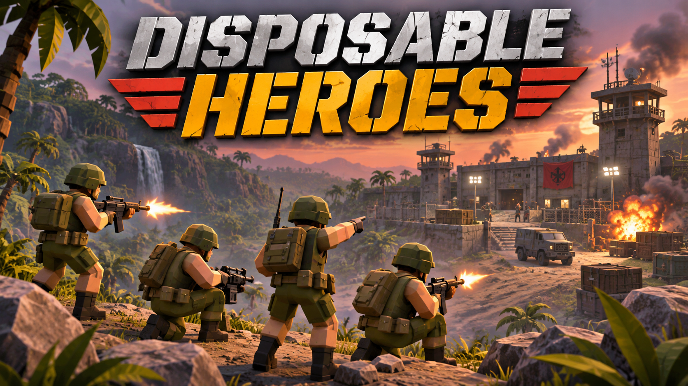

# Disposable Heroes

A Rust / Bevy 0.20 jungle squad-combat project inspired by Cannon Fodder. Native OpenFodder map import, Rust-generated models and audio, fixed-step combat, named soldiers and mission retry.



## Layout

Selected files and directories; comments describe their architectural role.

```text
.
├── .github/workflows/             # CI, semantic versioning and release delivery
│   ├── build.yaml                 # Test, check WASM compatibility and build Linux
│   ├── release-candidate.yaml     # Calculate semantic version; package web prerelease
│   ├── release.yaml               # Promote an unchanged candidate to stable
│   └── deploy-wavedash.yaml       # Upload stable web release; optionally publish
├── .devcontainer/                 # Version-controlled developer environment
│   ├── devcontainer.json          # Workspace, service and initialization settings
│   ├── devcontainer-lock.json     # Locked devcontainer feature versions
│   ├── Dockerfile                 # Rust/Bevy tools, Linux libraries, Vulkan and Blender
│   ├── compose.yaml               # Workspace mounts, GPU passthrough and service
│   ├── initialize-gpu.sh          # Generate host-specific render-group configuration
│   ├── rebuild.sh                 # Remove this container for a fresh rebuild
│   ├── bash_aliases               # Developer shell shortcuts
│   └── ps1.bash                   # Shell prompt
├── .cargo/config.toml             # Default target: x86_64-unknown-linux-gnu
├── .agents/skills/                # Bevy guidance and procedural asset authoring skill
│   └── 3d-assets/scripts/         # Reusable GLB-to-Blender inspection helper
├── Cargo.toml                     # Three-crate workspace; game is default member
├── Cargo.lock                     # Pinned Rust dependency versions
├── Justfile                       # Build, play and asset tasks (see below)
├── crates/
│   ├── seed.rs                    # Deterministic randomness shared by models and sound
│   ├── game/                      # disposable-heroes package
│   │   ├── src/
│   │   │   ├── main.rs            # CLI, map/campaign setup and Bevy app composition
│   │   │   ├── lib.rs             # Reusable logic exposed to binaries and tests
│   │   │   ├── importer.rs        # Native map/sprite/terrain data; browser map loading
│   │   │   ├── simulation.rs      # Renderer-independent battlefield and combat
│   │   │   ├── navigation.rs      # Deterministic routing on original collision grid
│   │   │   ├── tuning.rs          # Gameplay values and campaign aggression tuning
│   │   │   ├── campaign.rs        # Roster, progress, checkpoints and save format
│   │   │   ├── storage.rs         # Native file / browser localStorage persistence
│   │   │   ├── environment.rs     # Reviewed tile visuals and thicket placement
│   │   │   ├── game_flow.rs       # Screen states and mission lifecycle
│   │   │   ├── presentation.rs    # Battlefield rendering, input, camera, audio and effects
│   │   │   ├── ui/                # Menus, briefing, HUD, results and shared theme
│   │   │   └── bin/
│   │   │       ├── map-inspect.rs # Inspect original map data without rendering
│   │   │       ├── asset-gallery.rs # Preview or capture procedural models
│   │   │       └── asset-export.rs  # Optional GLB interoperability export
│   │   └── tests/                 # Import, simulation, campaign and screen lifecycle checks
│   ├── models/                    # Authoritative procedural geometry, materials and animation
│   │   ├── src/library/           # Individual model definitions
│   │   ├── src/geometry.rs        # Shared mesh construction helpers
│   │   ├── src/export.rs          # Optional GLB serialization
│   │   └── tests/                 # Model contracts and export validation
│   └── sound/src/lib.rs           # Authoritative synthesized rifle, explosion and jungle audio
├── assets/
│   ├── catalogs/jungle.json       # Reviewed original tile-to-visual mappings
│   └── shaders/water.wesl         # Water material shader
├── scripts/
│   ├── fetch_fixtures.py          # Download and checksum pinned OpenFodder data
│   ├── reference_tiles.py         # Decode reference tiles for visual review
│   └── check_input.sh             # Script native input smoke checks
├── tests/fixtures-manifest.json   # Upstream data revision and SHA-256 checksums
├── docs/
│   ├── format.md                  # Import formats and supported source data
│   ├── first-mission.md           # Visual reference and host acceptance checks
│   └── status.md                  # Implementation limits and remaining work
├── AGENTS.md                      # Agent-specific development and validation instructions
├── data/                          # Ignored: downloaded original map fixtures
├── saves/                         # Ignored: native campaign persistence
└── tmp/                           # Ignored: screenshots, benchmarks and optional exports
```

The importer feeds original map geometry, sprites and collision data into the
renderer-independent simulation. Bevy drives combat at 50 fixed steps per second;
presentation and UI translate player actions into commands and display battle
state. Campaign logic carries soldiers and progress between missions, with native
file or browser storage. Models, sound, material maps, soil normals and effect
textures are generated directly in memory from Rust definitions; the game and asset tools share that construction path. Exported
GLBs are optional interoperability outputs and are never game inputs.

## Run

Run commands from the repository root. The native target is
`x86_64-unknown-linux-gnu`; interactive playtesting happens on the Linux host.
The devcontainer supplies Rust, Vulkan, Blender and Linux development libraries.
Python is needed for fixture downloads and reference tools; building and running
with fixtures already present requires no Python, Blender or generated GLBs/WAVs.

```sh
python3 scripts/fetch_fixtures.py
just play --fresh
```

`just play` resumes the saved campaign. Native saves live in `saves/campaign.json`;
browser builds use localStorage. Surviving soldiers carry forward, retry restores
the mission-start roster, and `--fresh` starts a new campaign.

### Tasks

Optional positional arguments are shown in brackets, in recipe order.

| Command | Purpose / output |
| --- | --- |
| `just` or `just build` | Build the release Linux game. |
| `just play [game arguments]` | Build and launch the release game. |
| `just assets-build` | Build the native asset gallery separately. |
| `just assets-preview [model] [seed]` | Interactive library or selected model; seed defaults to `1993`. |
| `just assets-capture [output] [seed] [clip] [time]` | Offscreen contact sheet; defaults to `tmp/asset-library.png`, seed `1993`, no clip. With a clip, freeze at time (default `0.5` seconds). |
| `just assets-export [model] [seed] [output]` | Export one/all models as GLBs; defaults to seed `1993`, output `tmp/glb/`. |
| `just assets-blend [output] [seed]` | Export all models and import into headless Blender; defaults to `tmp/asset-library.blend`, seed `1993`. Requires Blender. |
| `just assets-validate` | Workspace tests with export support, then WASM compatibility checks; requires the `wasm32-unknown-unknown` target. |

For example, `just assets-capture tmp/run.png 1993 Run 0.5` captures an animation
pose. The gallery binary also accepts `--model`, `--seed`, `--clip` (continuous
playback), `--time` (freeze a pose) and `--output` (capture and exit).
See the [procedural asset authoring guide](.agents/skills/3d-assets/SKILL.md).

To inspect the full library in Blender, run `just assets-blend`, then open
`tmp/asset-library.blend`. Models are spaced in a grid at their original sizes,
with a named collection per asset and imported rigs and animation clips retained.
The saved viewport frames the library; select a model and press numpad `.` to
focus it. This optional export uses temporary GLBs and Blender's bundled Python;
it is separate from the game build and does not change the Rust asset sources.

### Game options

Pass these through `just play`, for example `just play --fresh --seed 42`.

| Options | Behavior / default |
| --- | --- |
| `--help` | Print options and controls, then exit. |
| `--data DIR` | Original data root; default `data`. |
| `--map FILE.map`, `--tilesets DIR` | Load a custom map/sprite pair; optionally specify its terrain resources. |
| `--campaign FILE.ofc --maps DIR` | Load an OpenFodder campaign and its map directory. |
| `--seed N`, `--asset-seed N` | Independent combat and procedural asset seeds; both default to `1993`. |
| `--fresh` | Start without loading the existing save. |
| `--smoke-test` | Capture `tmp/battlefield.png` offscreen and exit. |
| `--benchmark --benchmark-seconds N` | Offscreen performance run; default 20 seconds; report in `tmp/benchmark.json`. |
| `--combat-preview` | Capture scripted combat and a preview-only explosion in `tmp/combat.png` and exit. |

Save a `.map` / `.spt` pair in the existing OpenFodder editor and run:

```sh
just play --map '/path/My Mission.map' --tilesets data/Data/AmigaTheOne --fresh
just play --campaign '/path/Campaign.ofc' --maps '/path/maps' --tilesets data/Data/AmigaTheOne --fresh
cargo run --no-default-features --bin map-inspect -- data/Data/AmigaTheOne/mapm2.map
```

Terrain resources must include the base/subset `.hit`, `.bht` and `.swp` files
named by the map. Play currently supports jungle presentation; unsupported sprites
or objectives are reported before play. See the [importer reference](docs/format.md)
and [implementation limits](docs/status.md).

## Controls

| Input | Action |
| --- | --- |
| Left click / hold right click / both buttons | Move or select / fire / selected explosive. |
| `1`–`3`, `S`, `J` | Select squad, split a soldier, regroup. |
| `G`, `X` | Select grenades or rockets (require pickups; friendly fire applies). |
| `Enter`, `R` | Deploy or continue, retry. Squad-panel buttons also provide these actions. |
| Scroll / screen edges | Zoom / pan; camera tracks the active leader, briefly pausing after manual scrolling. |
| `F1`, `F12` | Toggle HUD, capture `tmp/battlefield.png`. |

## Validation

```sh
cargo test --no-default-features
cargo check --all-targets
just assets-validate
just play --fresh --smoke-test
```

Native graphics use HDR, bloom, ambient occlusion, FXAA and 2048-pixel directional
shadows. Browser builds retain the shared models and textures with 1024-pixel
shadows and lower particle budgets, without the desktop postprocessing passes.
Small model parts are merged by material and bone to keep foliage and soldier
detail from multiplying mesh instances. GLB exports embed the same generated
surface texture and projected UV coordinates used by the game and gallery.

Captures render offscreen without a desktop display. Smoke and combat captures
advance at a fixed 60 Hz so shader warmup cannot change the captured effect age.
Host playtesting remains the check for controls and performance; see the [first-mission acceptance notes](docs/first-mission.md).
For agent GPU diagnostics and visual output requirements, see [AGENTS.md](AGENTS.md#gpu-checks).

## Data provenance

[The fixture downloader](scripts/fetch_fixtures.py) fetches unmodified OpenFodder/data
files at the revision pinned in [the manifest](tests/fixtures-manifest.json),
verifies SHA-256 checksums, and stores them in ignored `data/`. Linux CI artifacts
include the downloader and manifest; web release archives bundle verified game
data, with `.swp` resources renamed to `.swp.bin` for browser hosting. Reference
images can be generated with `python3 scripts/reference_tiles.py`.
